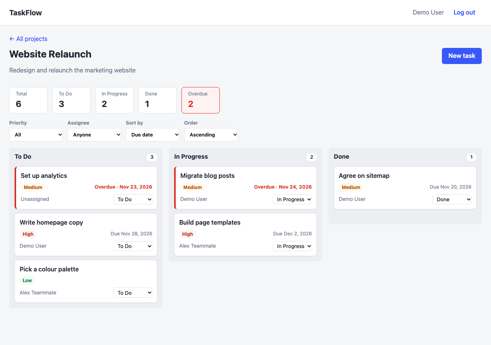

# TaskFlow

A small team task tracker: a Spring Boot + Kotlin REST API and a React + TypeScript frontend.

Users register, create projects, and manage tasks on a three-column board (To Do, In Progress, Done) with filters, sorting, overdue highlighting and a per-task activity log.



## Contents

- [Tech stack](#tech-stack)
- [Quick start (Docker)](#quick-start-docker)
- [Running locally without Docker](#running-locally-without-docker)
- [Running the tests](#running-the-tests)
- [API](#api)
- [Architecture](#architecture)
- [Design patterns](#design-patterns)
- [State management](#state-management)
- [Assumptions and trade-offs](#assumptions-and-trade-offs)
- [What I'd do next](#what-id-do-next)

## Tech stack

| Area | Choice |
| --- | --- |
| Backend | Kotlin 2.2, Spring Boot 3.5 (Web, Data JPA, Security, Validation), Gradle (Kotlin DSL) |
| Auth | Stateless JWT (jjwt), BCrypt password hashes |
| Database | PostgreSQL 16 (Docker) or in-memory H2 in PostgreSQL mode (local default), Flyway migrations |
| API docs | springdoc-openapi (Swagger UI) |
| Frontend | React 18, TypeScript, Vite, React Router 6, TanStack Query 5, axios |
| Tests | JUnit 5, MockK, Spring MockMvc; Jest + React Testing Library |
| Tooling | Docker Compose, GitHub Actions, ESLint |

## Quick start (Docker)

Needs Docker with Compose v2.

```bash
cp .env.example .env    # then set POSTGRES_PASSWORD and JWT_SECRET
docker compose up --build
```

- App: http://localhost:3000
- API: http://localhost:8080 (Swagger UI at http://localhost:8080/swagger-ui.html)

If port 3000 or 8080 is already in use, change `FRONTEND_PORT` / `BACKEND_PORT` in `.env`.

### Demo account

On startup the backend seeds a demo user with two projects and some tasks (including two overdue ones):

| Email | Password |
| --- | --- |
| `demo@taskflow.dev` | `Password123!` |

A second user, `alex@taskflow.dev` (same password), exists so tasks can be assigned to someone else. Seeding is skipped if the demo user already exists, and can be turned off with `SEED_ENABLED=false`.

## Running locally without Docker

Needs JDK 17+ and Node 20+.

**Backend** (in-memory H2, nothing else to install):

```bash
cd backend
export JWT_SECRET=$(openssl rand -base64 48)
./gradlew bootRun
```

To use PostgreSQL instead, also set `DB_URL`, `DB_USERNAME` and `DB_PASSWORD`.

**Frontend:**

```bash
cd frontend
npm install
npm run dev
```

Open http://localhost:5173. The Vite dev server proxies `/api` to `http://localhost:8080`; set `VITE_PROXY_TARGET` if the backend runs elsewhere.

### Configuration

All configuration comes from environment variables (see `backend/src/main/resources/application.yml`). No secrets are committed.

| Variable | Default | Notes |
| --- | --- | --- |
| `JWT_SECRET` | none (required) | At least 32 characters. The app won't start without it. |
| `JWT_EXPIRATION` | `PT2H` | ISO-8601 duration |
| `DB_URL` / `DB_USERNAME` / `DB_PASSWORD` | in-memory H2 | |
| `CORS_ALLOWED_ORIGINS` | `http://localhost:5173` | Comma separated |
| `SEED_ENABLED` | `true` | |
| `PORT` | `8080` | |

## Running the tests

```bash
cd backend && ./gradlew test     # 26 tests: service unit tests (MockK) + MockMvc integration test
cd frontend && npm test          # 20 tests: components (RTL) + small unit tests
```

Other frontend checks: `npm run lint`, `npm run typecheck`, `npm run build`.

GitHub Actions (`.github/workflows/ci.yml`) runs all of the above on every push and pull request.

What's covered:

- **Service unit tests** (`TaskServiceTest`, `ProjectServiceTest`, `AuthServiceTest`): task creation, validation of assignee and due date, status change + activity logging, ownership checks, summary counts, page size cap, duplicate email, bad login.
- **Integration test** (`TaskFlowApiIntegrationTest`, `@SpringBootTest` + MockMvc + H2 + Flyway): full task flow, 400 field errors, users can't see each other's projects, 401 for missing and expired tokens, 409 for duplicate email.
- **Frontend**: `TaskCard` (rendering, overdue highlight, status change), `TaskForm` (client validation, create/edit payloads, server field errors), `ProtectedRoute` (redirects when logged out or token expired), plus filter/validation helpers.

## API

All endpoints except register and login need an `Authorization: Bearer <token>` header. Full, interactive docs are in Swagger UI.

| Method | Endpoint | Purpose |
| --- | --- | --- |
| POST | `/api/auth/register` | Create a user, returns a JWT |
| POST | `/api/auth/login` | Returns a JWT |
| GET | `/api/projects` | Current user's projects |
| POST | `/api/projects` | Create a project |
| GET | `/api/projects/{id}` | Get one project |
| GET | `/api/projects/{id}/tasks` | List tasks (filters, sorting, pagination, see below) |
| POST | `/api/projects/{id}/tasks` | Create a task |
| GET | `/api/projects/{id}/summary` | Task count per status + overdue count |
| PUT | `/api/tasks/{id}` | Update a task |
| PATCH | `/api/tasks/{id}/status` | Change only the status |
| DELETE | `/api/tasks/{id}` | Delete a task |
| GET | `/api/tasks/{id}/activity` | Activity log for a task (bonus) |
| GET | `/api/users` | Users that a task can be assigned to |

**Task list query params:** `status`, `priority`, `assigneeId`, `sort` (`dueDate` \| `priority` \| `createdAt`, default `createdAt`), `direction` (`asc` \| `desc`), `page` (0-based), `size` (default 20, max 100).

Responses are paged:

```json
{ "content": [ ... ], "page": 0, "size": 20, "totalElements": 6, "totalPages": 1 }
```

**Errors** always have the same shape (from `GlobalExceptionHandler` and, for 401s, `RestAuthenticationEntryPoint`):

```json
{
  "timestamp": "2026-03-10T10:00:00Z",
  "status": 400,
  "error": "Bad Request",
  "message": "Validation failed",
  "path": "/api/projects/1/tasks",
  "fieldErrors": [
    { "field": "title", "message": "Title is required" },
    { "field": "dueDate", "message": "Due date cannot be in the past" }
  ]
}
```

## Architecture

```
taskflow/
├── backend/                     Spring Boot API
│   └── src/main/kotlin/com/taskflow/
│       ├── auth/                register/login controller, service, DTOs
│       ├── user/                User entity, repository, /api/users
│       ├── project/             Project entity, repository, service, controller
│       ├── task/                Task entity, repository, specifications, mapper, service, controller
│       │   ├── sort/            sort strategies + resolver
│       │   └── activity/        task activity log
│       ├── security/            JWT service, auth filter, 401 entry point
│       ├── common/              exceptions, error response, global exception handler, page DTO
│       └── config/              security, OpenAPI, clock, demo data seeder
├── frontend/                    React app
│   └── src/
│       ├── api/                 axios client, endpoint modules, types, error helpers
│       ├── hooks/               React Query hooks (one place for query keys + cache invalidation)
│       ├── features/            auth, projects and tasks UI + logic
│       ├── components/          reusable UI: Button, Modal, FormField, Spinner, ErrorMessage, ...
│       └── pages/               route-level screens
├── docker-compose.yml           postgres + backend + frontend (nginx)
└── .github/workflows/ci.yml
```

### Backend

Code is grouped **by feature** (auth, project, task) and each feature follows **controller → service → repository**:

- **Controllers** only handle HTTP: bind and validate the request, read the current user from `@AuthenticationPrincipal`, call the service. They never see JPA entities.
- **Services** hold the business rules and transactions: ownership checks, "due date not in the past", recording activity, building the summary.
- **Repositories** are Spring Data JPA interfaces.

Other notes:

- **Ownership.** Every project/task lookup goes through a query that includes the owner (`findByIdAndOwnerId`, `findByIdAndProjectOwnerId`). Someone else's project returns **404, not 403**, so ids of other users' data aren't revealed.
- **Security.** Stateless JWT. `JwtAuthenticationFilter` validates the token and sets the principal; if the token is expired it leaves a message that `RestAuthenticationEntryPoint` returns in the 401 body ("Your session has expired…").
- **Validation.** Bean Validation on request DTOs (`@NotBlank`, `@Size(max = 120)`, `@FutureOrPresent`). Rules that depend on existing state (e.g. a past due date is OK on update only if it didn't change) are in the service and throw `FieldValidationException`, so they come back in the same `fieldErrors` format.
- **Database.** Schema is owned by Flyway (`db/migration`); Hibernate only validates it (`ddl-auto: validate`). H2 runs in PostgreSQL mode so the same migrations work in both.
- **Time.** A `Clock` bean is injected wherever "today" matters (overdue, due-date validation, JWT expiry), which keeps tests deterministic.
- **N+1.** List queries use `@EntityGraph` to load the assignee/owner in the same query.

### Frontend

- `api/` is the only place that knows about HTTP. `client.ts` adds the bearer token and calls a registered handler on any 401.
- `hooks/` wraps every API call in a React Query hook. Mutations invalidate the board's task lists and summary, so columns and counts stay in sync after a move/edit/delete.
- **Board.** Each column is its own paged query (`useInfiniteQuery` with status filter, 20 per page, "Load more"). This uses the API's pagination properly instead of loading every task at once. Filters and sort live in the URL (`?priority=HIGH&sort=priority`), so a filtered board survives a refresh and can be shared.
- **Moving tasks.** Drag-and-drop (native HTML5) on desktop, and a status dropdown on every card, which also works on touch screens and with a keyboard.
- **Auth.** `AuthProvider` stores the session (token + expiry + user) in `localStorage`. The session ends, and the user is sent to login with a "session expired" message, either when the token's expiry time is reached (timer) or when the API returns 401.
- **States.** Every query renders loading, error (with Retry) and empty states. Every mutation shows its error and disables its button while pending.
- **Responsive.** CSS grid board with three columns on desktop that stack below 768px.

## Design patterns

| Pattern | Where | Why |
| --- | --- | --- |
| **Strategy** | `task/sort/TaskSortStrategy` with `DueDateSortStrategy`, `PrioritySortStrategy`, `CreatedAtSortStrategy`, picked by `TaskSortStrategyResolver` | Each sort has its own rules: due date puts tasks without a date last (H2 and Postgres disagree on default null order); priority sorts by rank (LOW < MEDIUM < HIGH) instead of alphabetically. Adding a sort is one new `@Component`; the resolver finds it through Spring and the error message for an unknown `sort` lists the valid values automatically. |
| **Specification** | `task/TaskSpecifications` | Each optional filter (status, priority, assignee) is a small composable predicate; only the ones that are set get combined. Avoids writing a repository method per filter combination. |
| **Repository** | `*Repository` interfaces (Spring Data JPA) | Keeps persistence out of the services, and makes services easy to unit test with MockK. |
| **Factory / Mapper** | `TaskMapper.newTask(...)` / `toResponse(...)`, `ProjectResponse.from(...)`, `UserResponse.from(...)`, `PageResponse.from(...)` | One place that builds entities from requests and DTOs from entities, so JPA entities never leak out of the API. |
| **Provider / Context** (frontend) | `AuthProvider` + `useAuth` | Single source of truth for the session, used by routes, the layout and the API client's 401 handling. |

## State management

**TanStack Query (React Query) for server state, React Context for auth, and the URL for board filters.**

Almost all the state in this app is server data (projects, tasks, summary, users). React Query gives caching, loading/error flags, retries and cache invalidation out of the box, which is exactly what the "loading, empty and error states for every API call" requirement needs. Redux Toolkit would mean writing slices and thunks for data that React Query already manages.

The only real client state is the logged-in session, which is small and changes rarely, so a Context is enough. Filters are kept in the URL search params rather than in a store so they survive refresh and back/forward.

## Assumptions and trade-offs

- **"Users can only see and change projects they own."** I took this literally: there's no project membership/sharing. A task can still be assigned to any registered user (that's the only way the assignee field makes sense without a teams feature), but the assignee can't see the project unless they own it. `GET /api/users` therefore lists all users; with a real teams model it would only list members.
- **Overdue** means `dueDate < today` and status is not `DONE`. "Today" is calculated on the server in UTC. The form uses the browser's local date for its `min` and client-side checks, so around midnight the two can differ by a day; the server is the source of truth.
- **Due date on update.** "Not in the past" is enforced on create. On update it's only enforced if the date changes, so you can still edit an already overdue task (e.g. to mark it done).
- **JWT in localStorage.** Simple and fits a stateless API, but readable by any script on the page if there were an XSS bug. An httpOnly cookie + CSRF protection would be safer. There's no refresh token; the user logs in again after 2 hours.
- **Default sort.** The API defaults to `createdAt`; the board defaults to due date (soonest first, no-date tasks last) since that's what the assignment asks the UI to support.
- **Board pagination.** Each column loads 20 tasks at a time. Column headers show the total for the status from the summary endpoint, and "x of y" when a filter is active.
- **Drag-and-drop** uses the native HTML5 API to avoid a dependency. It doesn't work on touch devices, which is why every card also has a status dropdown.
- **No optimistic updates.** After a move the column refetches (fast, and avoids rollback logic). The card is dimmed while the request is in flight.
- **Seed data.** The demo tasks are inserted directly, so they don't have a "created" entry in the activity log; anything you do in the UI is logged.
- **Docker build.** The backend image builds with the official `gradle:9.1.0-jdk17` image instead of the wrapper, so it doesn't have to download a Gradle distribution during the build.

## What I'd do next

- Project members/teams, so assignees can see their tasks and `/api/users` is scoped to a team.
- Refresh tokens (or httpOnly cookie sessions) instead of a 2-hour token in localStorage.
- Optimistic updates for moving tasks, and keyboard-accessible drag-and-drop (e.g. dnd-kit).
- Task ordering within a column.
- Testcontainers so the integration test runs against real PostgreSQL instead of H2.
- A few Playwright end-to-end tests in CI (I checked the main flows manually in a real browser against the Docker stack).
- Rate limiting on login/register.
